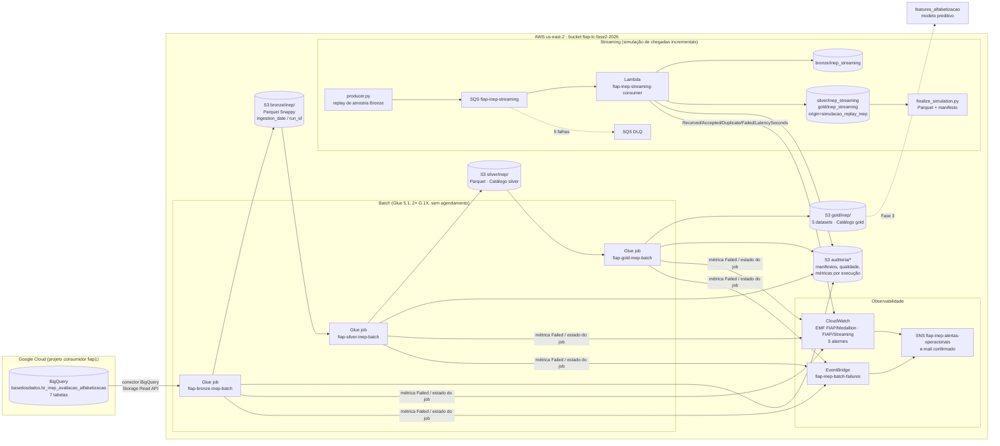

# Pipeline Híbrido para Análise da Alfabetização no Brasil

**Tech Challenge – Fase 2 | POSTECH FIAP – IA para Devs / Engenharia de Dados**

Pipeline batch + streaming em AWS, com Arquitetura Medalhão (Bronze → Silver → Gold), que integra as sete tabelas (incluindo o dicionário) do dataset `br_inep_avaliacao_alfabetizacao` da Base dos Dados (BigQuery) e produz uma camada analítica
versionada, auditada e pronta para a Fase 3 (modelo preditivo).

> **Vídeo executivo (até 5 min):** `[LINK PENDENTE – inserir antes da entrega]`

| | |
|---|---|
| Nuvem principal | AWS `us-east-2` (Ohio) – S3, Glue 5.1, Glue Data Catalog, SQS, Lambda, CloudWatch, SNS, EventBridge, Secrets Manager, Budgets |
| Fonte | Google BigQuery (`basedosdados.br_inep_avaliacao_alfabetizacao`) lido pelo conector BigQuery do Glue via projeto consumidor GCP |
| Volume ingerido | 7 tabelas, **3.902.954** linhas (Bronze = Silver, sem perda nem duplicata) |
| Camada Gold | 5 datasets, **46.342** linhas, catalogados em `tech_challenge_fase2_gold` |
| Validação cruzada Brasil (rede pública, 2º ano) | 2024: recalculada 59,1996 % × oficial 59,2 % (**−0,0004 p.p.**) · 2023: 57,4622 % × 55,9 % (+1,5622 p.p., cobertura diferente – ver Limitações) |
| Streaming | 30 eventos válidos + 5 reenvios + 1 inválido; latência evento → Gold de simulação: mediana **0,181 s**, P95 5,997 s |
| Custo projetado | Subtotal **US$ 2,15 / 30 dias** (19 parcelas medidas; 2 pendentes) – ambiente com créditos, teto total do projeto US$ 140 |

---

## 1. Contexto do problema

O **Compromisso Nacional Criança Alfabetizada** (CNCA) estabelece que toda criança deve estar alfabetizada ao
final do 2º ano do ensino fundamental. Em 2023 o INEP definiu, a partir da Pesquisa Alfabetiza Brasil, o ponto de
corte de **743 pontos** na escala Saeb; o **Indicador Criança Alfabetizada** é o percentual de estudantes avaliados
que atinge esse patamar.

Analisar o indicador exige integrar fontes heterogêneas: microdados de alunos (proficiência, presença,
preenchimento, peso amostral), indicadores agregados por município e UF, e as metas pactuadas 2024–2030 nos três
níveis (Brasil, UF, município), além do dicionário que traduz os códigos categóricos. Esta pipeline faz essa
integração com rastreabilidade de ponta a ponta e com validações que **impedem** dado inconsistente de chegar à
camada analítica.

**Meta 2030 – duas leituras, tratadas separadamente.** A meta pactuada da fonte (`meta_alfabetizacao_2030`, 80 para a
rede pública) é a que alimenta as colunas `meta_alfabetizacao_ano`, `distancia_ate_meta_pp` e
`distancia_ate_meta_2030_pp`. A universalização (100 %) não é usada em nenhum cálculo; se aparecer em apresentação,
é identificada como **cenário aspiracional**.

---

## 2. Arquitetura implementada



O diagrama mostra **o que foi executado**. Não há Databricks, Athena, Step Functions, Airflow nem agendamento:
os publicadores `deploy/deploy_bronze.py` e `deploy/deploy_continuacao.py` criam/atualizam os jobs sem
iniciá-los. As execuções batch foram disparadas separadamente pelo console/CLI; os scripts de `streaming/`
conduziram o replay. Cada etapa batch recebe explicitamente o manifesto aprovado da anterior.

### Fluxo de dados em uma execução batch

1. **Bronze** lê cada tabela do BigQuery pelo conector, acrescenta `id_ingestao`, `data_ingestao` e
   `tabela_origem`, grava Parquet Snappy em `bronze/inep/<tabela>/ingestion_date=…/run_id=<JobRunId>/`,
   **relê o destino** e compara contagens. Publica `auditoria/bronze/…/manifest.json` com `SUCCEEDED` só ao final.
2. **Silver** recebe `--BRONZE_MANIFEST_URI`, recusa manifesto que não seja `SUCCEEDED` + `is_full_batch=true`,
   normaliza tipos/chaves, deduplica com desempate determinístico, decodifica nove colunas pelo `dicionario`,
   deriva `avaliado` e `alfabetizado_avaliado`, valida pesos, grava `silver/inep/<tabela>/process_date=…/run_id=…/`
   e registra o catálogo `tech_challenge_fase2_silver`.
3. **Gold** recebe `--SILVER_MANIFEST_URI`, verifica o contrato de colunas/tipos da Silver, constrói os cinco
   datasets, audita a taxa de correspondência de **cada** junção, publica em `gold/inep/<dataset>/run_id=…/` e
   registra tabelas versionadas no `tech_challenge_fase2_gold`. O manifesto `SUCCEEDED` é o objeto de
   aprovação do conjunto, gravado após as tabelas serem registradas. A escrita dos Parquet e dos registros
   do catálogo não é uma transação única. Consumidores devem conferir esse manifesto e usar somente seus
   caminhos aprovados; uma entrada de catálogo isolada não comprova publicação.

---

## 3. Tecnologias utilizadas

| Camada | Tecnologia | Por quê | Status |
|---|---|---|---|
| Fonte | BigQuery (Base dos Dados) via conector Glue + Secrets Manager (credencial GCP) | `alunos` (3,87 M linhas) é grande demais para download manual; conector elimina etapa intermediária e credencial fica fora do código | Implementado |
| Armazenamento | S3 + Parquet Snappy, partições por data e `run_id` | Colunar, comprimido, histórico por execução sem sobrescrita | Implementado |
| Processamento batch | AWS Glue 5.1 (Spark 3.5), 2 workers G.1X por job | Serverless, cobrança por DPU-segundo, mesmo motor dos notebooks originais | Implementado |
| Catálogo | Glue Data Catalog (`…_silver`, `…_gold`) | Tabelas versionadas apontando para o `run_id` publicado | Implementado |
| Mensageria / streaming | SQS Standard + DLQ, Lambda Python 3.12 (concorrência 2, lote ≤ 5, `ReportBatchItemFailures`) | Entrega pelo menos uma vez, retentativa e DLQ nativas, custo marginal ~zero | Implementado (simulação por replay) |
| Observabilidade | CloudWatch EMF, 5 alarmes, EventBridge, SNS e-mail | Métricas persistidas por execução; notificação fora do console | Implementado |
| FinOps | Cost Explorer, AWS Budgets (US$ 30/mês, limiares 15/24/30), limites de workers/timeout | Medição real + Budget configurado; contato de faturamento pendente de verificação | Parcial |
| IaC | CloudFormation (stack `fiap-inep-streaming`) | Fila, DLQ, Lambda, role, 3 alarmes | Parcial – ver §9 |
| Orquestração | — | — | **Evolução futura** (Glue Workflow/trigger) |
| Testes | `unittest` com fixtures locais (clientes AWS simulados; Gold valida contrato e cobertura sem Spark real) | 132 testes originais + 6 verificações de IaC aprovados localmente; ambiente identificado na seção 9 | Implementado |

---

## 4. Decisões arquiteturais e trade-offs

**Forma de acesso à fonte – BigQuery via conector, não download.**
*Por quê:* a tabela `alunos` tem 3.867.999 linhas (256,1 MB lógicos); o download pelo site falhou e o CSV
intermediário no Drive criaria uma cópia sem versão. O conector lê direto para o Spark.
*Custo:* uma leitura integral das sete tabelas corresponde a **271.547.681 bytes lógicos** (0,000247 TiB) pela
BigQuery Storage Read API (US$ 1,10/TiB → US$ 0,0003 por ciclo). O que o Cost Explorer da AWS **não** mostra é o
egress GCP → AWS (tarifa US$ 0,12/GiB); o projeto consumidor está sem conta de faturamento e a quantidade
permanece **não medida** (ver §8; tarifa de referência condicional, sem rota/SKU faturável confirmado).
*Quando a fonte for atualizada:* nada muda automaticamente. Uma nova execução Bronze cria novo `run_id` e novo
manifesto; Silver e Gold só consomem o manifesto que receberem por parâmetro. Snapshots anteriores continuam
intactos. Não há agendamento instalado; a cadência de 4 ciclos/mês usada no FinOps é hipótese do grupo.

**Batch × streaming.** Metas e microdados são publicações anuais: batch. O streaming simula chegadas incrementais
(replay de uma amostra real da Bronze) e tem semântica diferente, documentada em `streaming/LEIA-ME.txt`:

| | Batch (Glue) | Streaming (SQS + Lambda) |
|---|---|---|
| Latência | execução Glue: 146 s Bronze, 219 s Silver, 174 s Gold; manifesto Bronze mede trecho interno de 94,407 s | sub-segundo a segundos (mediana 0,181 s até a contribuição Gold) |
| Frequência | por publicação da fonte | contínua, por evento |
| Garantias | execução isolada e versionada por `run_id`; conjunto publicado pelo manifesto `SUCCEEDED`; catálogo sem transação atômica entre tabelas | pelo menos uma vez; idempotência por `(run_id, event_id)` com PUT condicional; mesmo ID com conteúdo diferente é rejeitado |
| Falha | job FAILED, auditoria de falha persistida e ausência de manifesto SUCCEEDED; arquivos staged podem permanecer | evento inválido vai para DLQ após 5 recebimentos; `QUALITY_REJECTED` persistido; sem Silver/Gold |
| Origem | dados oficiais em `bronze/inep`, `silver/inep`, `gold/inep` | prefixos `*_streaming`, coluna `origin=simulacao_replay_inep`, `simulation=true` – nunca se mistura ao oficial |

**Data lake × data warehouse.** S3 + Parquet + Glue Catalog (lakehouse mínimo) em vez de Redshift: o volume
(≈ 255 MB no bucket) não justifica cluster; o catálogo entrega esquema e consultas SQL quando necessário.

**Custo × desempenho.** 2 workers G.1X por job; Bronze em 4 partições para `alunos` e 1 para as pequenas.
Sem `persist` desnecessário além do cache por tabela. O job piloto legado com 10 workers foi reduzido (§6).

**Multi-cloud (GCP como fonte, AWS como plataforma).** Decisão imposta pela fonte, não por preferência. O que ela
cobra, e como foi tratado:
- egress GCP → AWS: tarifa conhecida, **quantidade não medida** (sem billing no projeto GCP);
- duas contas de billing: Cost Explorer na AWS, Cloud Billing/auditoria no GCP – conciliadas no modelo FinOps;
- dois modelos de identidade: credencial GCP guardada no Secrets Manager e referenciada pela conexão Glue;
  IAM AWS com role dedicada por componente (`streaming/iam_role_review.json`);
- duplicação de armazenamento: inexistente – não há cópia intermediária, o dado vai do BigQuery ao S3;
- equipe em dois ecossistemas: mitigado concentrando toda a lógica na AWS e usando o GCP só como leitura.

**Limiar de 95 % para taxa de correspondência.** Escolhido porque as três junções de metas devem casar quase
integralmente (meta sem resultado é lacuna da fonte, não falha de chave), e porque a junção município → microdados
tem ausências conhecidas (municípios com resultado oficial mas sem alunos avaliados no snapshot). Abaixo de 95 %
a perda deixa de ser explicável por lacuna da fonte e passa a indicar chave errada – e a execução para.

---

## 5. Arquitetura Medalhão – o que cada camada garante

### Bronze (`bronze/bronze_glue.py`)
- 7 tabelas, 3.902.954 linhas, Parquet Snappy, 3 colunas de metadados de ingestão; campos de origem preservados.
- **Política de escrita: `errorifexists` em caminho que inclui `run_id`.** Nenhuma execução sobrescreve outra;
  reutilizar `run_id` falha no `start.json` condicional (`IfNoneMatch=*`). Histórico completo preservado por construção.
- Regras bloqueantes: origem vazia, contagem origem ≠ destino (releitura do S3), colunas divergentes, Parquet ausente.
- Evidência: `evidencias/bronze/manifesto_bronze.json` (run `jr_cdfd2933…`, 94,407 s internos do manifesto; Glue: 146 s / 293 DPU-s; `all_counts_match=true`),
  `contagens_bronze.csv`, `execucao_glue.jpg`, `evidencias/capturas_console/02…04`.

### Silver (`silver/silver_glue.py`)
- Consome **um** manifesto Bronze aprovado; nunca une diretórios históricos.
- Normalização de tipos e chaves (`id_municipio` com 7 dígitos, vazios → nulo), deduplicação por chave natural com
  desempate determinístico (0 linhas removidas neste snapshot), decodificação de 9 colunas pelo `dicionario`
  (cobertura 100 %, regra bloqueante por coluna), domínios booleanos exigidos iguais ao dicionário
  (categoria desconhecida **não** vira `false`), `avaliado = presente ∧ caderno_preenchido`,
  `alfabetizado_avaliado` nulo para não avaliados, peso inválido em avaliado = bloqueio.
- 350 regras registradas (343 bloqueantes), 0 reprovadas; resultado em `auditoria/silver/…/manifest.json`.
- Evidência: `evidencias/silver/report_silver.json` (run `jr_9c58c50a…`, 219 s).

### Gold (`gold/gold_glue.py` v1.0.2)

| Dataset | Linhas | Conteúdo |
|---|---|---|
| `indicador_municipio` | 23.995 | município × ano × série × rede: taxa oficial + taxa recalculada dos microdados (ponderada por `peso_aluno`, denominador = avaliados) |
| `resultado_vs_meta` | 10.948 | município (rede 3), UF e Brasil (rede 5) × meta do ano; `status_meta ∈ {atingiu, nao_atingiu, sem_meta, sem_resultado}`; distâncias em p.p. |
| `evolucao_temporal` | 52 | série UF/Brasil com variação anual; **sem projeção** (dois pontos) |
| `validacao_cruzada_brasil` | 2 | taxa recalculada × oficial publicada + 8 campos de cobertura/comparabilidade |
| `features_alfabetizacao` | 11.345 | features em *t* → alvo em *t+1*, para a Fase 3 |

Cuidados do enunciado, onde estão no código:
- média ponderada, não simples: `taxa_calculada_microdados` (soma de `peso_aluno × alf` / soma de `peso_aluno`);
- denominador = alunos **avaliados** com peso válido, não total de registros;
- nulo preservado (`sem_meta` ≠ `nao_atingiu`; meta ausente nunca vira 0);
- mesmo recorte de rede e série: município rede 3 ↔ meta "Municipal"; UF/Brasil rede 5 ↔ meta "Pública"; série 2;
  mapeamento validado por regra bloqueante `rede_de_meta_sem_mapeamento` e pela checagem `consistencia_taxa`;
- categoria desconhecida é bloqueio, não fallback (`status_meta_valores_permitidos`, `microdados_rede_elementar`).

---

## 6. Qualidade de dados

Toda regra é registrada com `tipo ∈ {bloqueante, informativa}`, valor medido, limite e resultado, e **persistida
no S3** (`auditoria/<camada>/…/manifest.json` ou `failed.json`). Regra bloqueante reprovada levanta exceção que
**não é capturada**: o job Glue termina `FAILED` e a camada seguinte não recebe manifesto `SUCCEEDED`.

**Taxa de correspondência dos joins (obrigatória)** – medida após cada junção, universo elegível declarado:

| Junção (Gold 1.0.2) | Casaram | Taxa | Limiar | Resultado |
|---|---|---|---|---|
| município → microdados recalculados | 23.193 / 23.995 | 96,66 % | 95 % | aprovado |
| município (rede 3) → `meta_alfabetizacao_municipio` | 10.654 / 10.896 | 97,78 % | 95 % | aprovado |
| UF (rede 5) → `meta_alfabetizacao_uf` | 49 / 49 | 100 % | 95 % | aprovado |
| Brasil → `meta_alfabetizacao_brasil` | 2 / 2 | 100 % | 95 % | aprovado |
| features *t* → alvo *t+1* | 11.345 / 11.547 | 98,25 % | 95 % | aprovado |
| features → meta contextual | 5.302 / 5.396 | 98,26 % | 95 % | aprovado |

**O pipeline falhando – evidência real, não simulada.**
Em 22/10/2026 a primeira execução Gold (`jr_737aa335…`) **reprovou** na regra bloqueante
`taxa_correspondencia:consistencia_meta_uf x uf = 0,9074 < 0,95` e terminou `FAILED` sem publicar nada
(`evidencias/gold/v1_0_1_2026_10_22/manifesto_falha_regra_bloqueante_jr_737aa335.json`). A métrica `Failed=1`
levou o alarme `fiap-gold-inep-failure` de `OK` para `ALARM` às 14:07:56 UTC (`evidencias/gold/v1_0_1_2026_10_22/cloudwatch_snapshot_historico_alarmes.json`).

*Como foi resolvido – e por que não foi "afrouxar":* a verificação media **meta → resultado** (49 de 54 metas
UF/ano com resultado). A correção v1.0.1 inverteu o sentido para **resultado → meta** (todo resultado oficial
publicado precisa de meta comparável: 49/49), mantendo o limiar de 95 %. As 5 metas sem resultado e as 27 metas de
outros anos ficaram como diagnóstico informativo (`meta_sem_resultado`). A presença de uma meta não autoriza
inventar um resultado; a ausência de resultado é lacuna da fonte, não falha de chave.

Outras falhas preservadas: tentativa 1 da Gold 1.0.2 (`jr_8544c209…`, 26/10, `SparkRuntimeException` por `tuple`
em `isin`) e, no streaming, o evento com peso zero em aluno avaliado → `QUALITY_REJECTED`, mensagem na DLQ,
finalizador `FAILED` em 0,098 s sem publicar (`evidencias/observabilidade/resultado_observabilidade.json`).
O parâmetro `--DEMO_FAILURE true` da Gold força uma taxa de 150 % para reproduzir um bloqueio sob demanda.

**Investigação documentada – divergência nacional de 2023.** A taxa recalculada dos microdados (57,46 %) ficou
1,56 p.p. acima da publicada (55,9 %), fora da tolerância informativa de 0,1 p.p.; 2024 ficou dentro (−0,0004 p.p.).
A apuração (`gold/diagnostico/resultados/`, Leia-me dos microdados AEEB 2023/2024 em `docs/referencias_inep/`)
mostrou que o snapshot de `alunos` 2023 cobre 23 UFs – **sem AC, DF, RR e SP** – enquanto a tabela `uf` traz
resultado para SP. O dataset registra `status_comparabilidade = COBERTURA_DIFERENTE_ENTRE_BASES` e os conjuntos de
UFs de cada lado. Não se atribuiu toda a diferença a SP nem se ajustou dado para aproximar o número oficial.

---

## 7. Monitoramento e observabilidade

**Métricas persistidas, acumulando execuções** – cada run grava em `auditoria/<camada>/…/` início, duração por
etapa, linhas de entrada/saída, status e erro; nada é sobrescrito. Os jobs emitem EMF `FIAP/Medallion Failed`
(dimensões `Layer`, `JobName`); o Lambda emite `FIAP/Streaming` `Received/Accepted/Duplicate/Failed/LatencySeconds`.
O finalizador 2.0.1 grava `metrics.json` por tentativa (UUID, fases, bytes, duração por `perf_counter`).

**Latência medida de fato** – `end_to_end_latency_seconds = completed_at − event_time`, com `event_time` gravado
pelo produtor e `completed_at` pelo consumidor (carimbos independentes). 30 amostras: mín 0,155 s, mediana 0,181 s,
média 1,173 s, P95 5,997 s, máx 8,045 s. A medição não isolou a contribuição de cold start,
espera de lote ou outros fatores; não se atribuiu uma causa exclusiva à cauda.

**Notificação** – tópico SNS `fiap-inep-alertas-operacionais` com assinatura de e-mail confirmada; 5 alarmes com
`AlarmActions` para o tópico; regra EventBridge `fiap-inep-batch-failures` para `FAILED/TIMEOUT/STOPPED/ERROR/EXPIRED`
dos três jobs Glue. Teste autorizado em 27/10 às 20:03:54 UTC: ação SNS `Succeeded`, 1 entrega / 0 falhas, recebimento
confirmado pelo destinatário (`evidencias/observabilidade/`).

| Alarme | Condição | Período |
|---|---|---|
| `fiap-silver-inep-failure` / `fiap-gold-inep-failure` | `FIAP/Medallion Failed ≥ 1` | 60 s, 1 avaliação |
| `fiap-inep-streaming-rejected` | `FIAP/Streaming Failed ≥ 1` | 60 s |
| `fiap-inep-streaming-dlq` | mensagens visíveis na DLQ ≥ 1 | 60 s |
| `fiap-inep-streaming-age` | mensagem mais antiga ≥ 120 s | 60 s |

**Em produção, quem descobre que o pipeline quebrou, e em quanto tempo?**
Quem descobre é o destinatário operacional assinante do tópico SNS, por e-mail (assinatura e recebimento do
teste confirmados). O tempo é da **ordem de minutos**, e o único dado medido é de uma falha real:

- 22/10/2026, run Gold `jr_737aa335…` reprovado por regra bloqueante: o manifesto de falha foi gravado às
  14:06:02 UTC; a métrica `FIAP/Medallion Failed = 1` aparece no **minuto agregado** 14:06; o alarme
  `fiap-gold-inep-failure` passou de `OK` para `ALARM` às 14:07:56 UTC
  (`evidencias/gold/v1_0_1_2026_10_22/cloudwatch_snapshot_historico_alarmes.json`). Entre o início do minuto da
  métrica e a transição há 1 min 56 s; entre a gravação do manifesto de falha e a transição, 1 min 54 s. O
  instante exato da emissão da métrica não está registrado, e naquela data não havia SNS: o número mede a
  detecção pelo alarme, **não** a entrega de e-mail.
- Caminhos de aviso: falha de estado dos três jobs → regra EventBridge → SNS; alarmes com período de 60 s e
  uma avaliação; idade da fila ≥ 120 s. No teste de 27/10 a ação CloudWatch → SNS terminou `Succeeded`, com uma
  entrega e zero falhas na janela.

O que esses números **não** são: SLA. Ingestão da métrica, avaliação, encaminhamento e leitura do e-mail somam
tempo não medido. `NumberOfNotificationsDelivered` é agregado por minuto (o ponto de 20:03:00 UTC não é instante
de chegada); a confirmação humana foi registrada às 20:16:06 UTC sem medir a chegada à caixa postal. Não há
evidência de entrega em menos de um segundo.

Não há alarme de ausência de execução (etapas sem agendamento). O **Budget financeiro é outro canal**:
limiares configurados, último contato observado `0/1 verified; Inactive`, entrega de e-mail não comprovada.
O SNS operacional confirmado não verifica esse contato. Budget não bloqueia gasto e US$140 é o teto total.

---

## 8. FinOps

Práticas aplicadas: Parquet Snappy e partição por execução; leitura de um manifesto por vez; `coalesce` ajustado
ao tamanho da tabela; 2 workers G.1X e timeouts de 15–30 min nos jobs; job piloto legado reduzido de
10 G.1X/480 min para 2 G.1X/30 min (exposição por timeout de US$ 35,20 para US$ 0,44); logs Lambda com retenção
de 14 dias; Budget mensal US$ 30 com limiares configurados em US$ 15/24/30, mas contato de faturamento
com verificação pendente e entrega de e-mail não comprovada; um único segredo no Secrets Manager.

**Ambiente:** conta com créditos (US$ 136,59 em 27/10; US$ 3,41 de uso bruto histórico). Teto **total** do projeto:
US$ 140. A projeção abaixo é do mesmo desenho em produção, com a cadência hipotética de **4 ciclos batch + 4 replays
por 30 dias**.

| Serviço / parcela | Unidade | Quantidade medida | Base | Preço unitário (US$) | Custo 30 dias (US$) |
|---|---|---|---|---|---|
| AWS Glue – Bronze batch | DPU-hora | 0,0814 | por ciclo | 0,44 | 0,1432 |
| AWS Glue – Silver batch | DPU-hora | 0,1436 | por ciclo | 0,44 | 0,2528 |
| AWS Glue – Gold batch | DPU-hora | 0,0850 | por ciclo | 0,44 | 0,1496 |
| Amazon S3 – armazenamento Standard | GB-mês | 0,2552 | estoque | 0,023 | 0,0121 |
| Amazon S3 – PUT/COPY/POST/LIST | requests | 690 | janela 6 d | 0,000005 | 0,0173 |
| Amazon S3 – GET e Tier 2 | requests | 1.032 | janela 6 d | 0,0000004 | 0,0021 |
| CloudWatch Logs – ingestão | GB | 0,0177 | janela 6 d | 0,50 | 0,0379 |
| CloudWatch Logs – arquivo atual | GB-mês | 0,0069 | estoque | 0,03 | 0,0002 |
| CloudWatch Logs – crescimento do arquivo | GB-mês | **n.a.** | pendente | 0,03 | **n.a.** |
| CloudWatch – métricas customizadas | métrica-hora | 314 | por ciclo | 0,000417 | 0,5233 |
| CloudWatch – 5 alarmes | alarme-mês | 5 | mensal | 0,10 | 0,5000 |
| Lambda – consumidor 256 MB | GB-s | 4,407 | por ciclo | 0,0000167 | 0,0003 |
| Lambda – invocações | requests | 39 | por ciclo | 0,0000002 | 0,0000 |
| SQS – requests (inclui polling) | requests | 55.158 | janela 6 d | 0,0000004 | 0,1103 |
| Secrets Manager – 1 segredo | segredo-mês | 1 | mensal | 0,40 | 0,4000 |
| Secrets Manager – API | requests | 1 | janela 6 d | 0,000005 | 0,0000 |
| Glue Data Catalog – objetos | objeto-mês | 2,46 | janela 6 d | 0,00001 | 0,0001 |
| Glue Data Catalog – requests | requests | 91 | janela 6 d | 0,000001 | 0,0005 |
| Amazon S3 – entrada de dados | GB | 0 (janela sem ciclo) | janela 6 d | 0,00 | 0,0000 |
| Google Cloud – leitura das 7 tabelas (Storage Read) | TiB | 0,000247 | por ciclo | 1,10 | 0,0011 |
| Google Cloud – egress GCP → AWS | GiB | **n.a.** | pendente | 0,12 | **n.a.** |
| **Subtotal (19 parcelas)** | | | | | **2,1507** |

Fontes: DPU-segundos dos runs Glue, `GetMetricData`/logs Lambda, inventário S3, Cost Explorer diário
(`evidencias/finops/`), tabelas de preço regionais (`finops/tarifas_oficiais.json`). Modelo completo em
`finops/modelo_finops.json`; planilha em `evidencias/finops/FinOps_FIAP_Medicoes_Atualizado.xlsx`.
**Leia `finops/NOTA_JANELAS_DE_MEDICAO.md`:** as parcelas "janela 6 d" vêm de um período **sem ciclo Bronze nem
replay** e subestimam o mês; os dois `n.a.` não foram imputados como zero.

---

## 9. Reprodutibilidade – como executar

### Pré-requisitos
- Conta AWS com S3, Glue 5.1, Lambda, SQS, CloudWatch, SNS, EventBridge e Secrets Manager em `us-east-2`.
- Projeto GCP com BigQuery API habilitada; credencial de service account guardada **no Secrets Manager** e
  referenciada por uma conexão Glue do tipo BigQuery (`CONNECTION_NAME`). Nenhuma credencial está neste repositório.
- Python ≥ 3.11 local: `pip install -r requirements.txt`.

### Configuração
Os jobs Glue recebem tudo por *Job parameters* (`--BUCKET`, `--PREFIX`, `--CONNECTION_NAME`, `--PARENT_PROJECT`,
`--SOURCE_DATASET`, `--BRONZE_MANIFEST_URI`, `--SILVER_MANIFEST_URI`, `--LIMIAR_JOIN`, …); `env.example`,
`silver/job_defaults.json` e `gold/job_defaults.json` listam os valores usados nas execuções de referência.

**Identificadores ainda fixos em código (limitação declarada):** `deploy/deploy_bronze.py` grava os defaults do
bucket/projeto GCP; `deploy/deploy_continuacao.py` e `deploy/verify_continuacao.py` trazem `ACCOUNT`, `REGION` e
`ASSETS` como constantes (o primeiro recusa rodar em outra conta); `streaming/build_stack.py` fixa nomes de fila,
função e role. Para reproduzir em outra conta, ajuste essas constantes antes de executar.

### Estudar e verificar localmente (sem AWS)

Para analisar esta entrega, use as evidências já salvas e os testes abaixo. A correção de 28/10 não
executou comandos AWS/GCP, instalou dependências pela rede ou enviou notificações. A conta foi observada
pela última vez em 27/10: esta documentação não atualiza saldo, estado dos recursos ou preços.

```bash
python -m unittest discover -s silver -p "test_*.py"                      # 7 testes
python -m unittest discover -s gold -p "test_*.py"                        # 24 testes
python -m unittest discover -s streaming -p "test_*.py"                   # 96 testes
python -m unittest discover -s observabilidade/scripts -p "test_configure_notifications.py"  # 5 testes
python -m unittest discover -s tests -p "test_*.py"                       # 6 verificações locais de IaC
```

Na revisão local de 28/10, os 132 testes originais passaram no ambiente existente Python 3.13.14,
boto3 1.43.115 e PyArrow 26.0.0. As 6 verificações adicionais comparam a proposta às evidências e ao
gerador, sem simular aceite pelo serviço CloudFormation. Resultado final em `validacao_local.json`.
Não foi comprovado um novo clone/venv Python 3.12 nesta correção.
`manifesto_bronze.json` é a fixture de `silver/test_manifest_contract.py`.
`observabilidade/scripts/test_alarm_delivery.py` força alarme real e envia e-mail: não é teste unitário
e não foi executado nesta correção. Não o inclua em descoberta genérica de testes.

### Executar a pipeline de ponta a ponta (ordem obrigatória)

> **Aviso:** tudo abaixo altera a nuvem ou processa dados e consome créditos (teto total do projeto US$ 140).
> Nada disto foi executado na revisão de 28/10. Na conta atual os três jobs e a stack **já existem**: para
> conferir o que foi entregue use `evidencias/` e os testes offline, não uma nova criação. Em outra conta,
> ajuste antes os identificadores fixos listados em "Configuração", as permissões e os custos.

Cada etapa recebe explicitamente o manifesto `SUCCEEDED` da anterior; os defaults preservados apontam para os
snapshots históricos e devem ser substituídos pelos manifestos da nova execução, nunca misturados.

```bash
# 1. Bronze -- o publicador cria o job clonando role e conexão BigQuery de um job existente; não inicia execução
python deploy/deploy_bronze.py --region us-east-2 --source-job <job-com-conexao-bigquery> --job-name fiap-bronze-inep-batch --script-file bronze/bronze_glue.py
aws glue start-job-run --region us-east-2 --job-name fiap-bronze-inep-batch          # parâmetros: env.example
python bronze/verify_bronze.py --run-id <JobRunId> --date <AAAA-MM-DD> --output bronze_report.json --csv contagens_bronze.csv

# 2. Silver -- recebe o manifesto Bronze aprovado
python deploy/deploy_continuacao.py --layer silver --directory silver --defaults-json silver/job_defaults.json --output deployment_silver.json
aws glue start-job-run --region us-east-2 --job-name fiap-silver-inep-batch --arguments '{"--BRONZE_MANIFEST_URI":"s3://<bucket>/auditoria/bronze/ingestion_date=<data>/run_id=<run>/manifest.json"}'
python deploy/verify_continuacao.py --layer silver --run-id <JobRunId> --output report_silver.json --verify-parquet

# 3. Gold -- recebe o manifesto Silver aprovado
python deploy/deploy_continuacao.py --layer gold --directory gold --defaults-json gold/job_defaults.json --output deployment_gold.json
aws glue start-job-run --region us-east-2 --job-name fiap-gold-inep-batch --arguments '{"--SILVER_MANIFEST_URI":"s3://<bucket>/auditoria/silver/process_date=<data>/run_id=<run>/manifest.json"}'
python deploy/verify_continuacao.py --layer gold --run-id <JobRunId> --output report_gold.json --verify-parquet
python deploy/verificar_cobertura_publicada.py --output-dir <dir-novo>
# bloqueio sob demanda (run isolado, nunca publica): acrescente "--DEMO_FAILURE":"true" aos argumentos da Gold

# 4. Streaming -- criação inicial da stack (ambiente novo) e replay controlado
python streaming/build_stack.py                                   # gera streaming_stack.json + iam_role_review.json
aws cloudformation deploy --stack-name fiap-inep-streaming --template-file streaming/streaming_stack.json --capabilities CAPABILITY_NAMED_IAM --region us-east-2
python streaming/producer.py --queue-url <url-da-fila> --events 30 --output-dir <dir-novo>
python streaming/verify_simulation.py --events <dir>/events.jsonl --producer-report <dir>/producer_report.json --output verification.json
python streaming/finalize_simulation.py --events <dir>/events.jsonl --output-dir <dir-novo>   # Parquet + manifesto da Gold de simulação
# streaming/exercise_simulation.py executa a rodada completa (30 válidos + 5 reenvios + 1 inválido) e verify_negative_simulation.py confere a rejeição

# 5. Notificações -- cinco etapas distintas; nenhuma é automática a partir da anterior
python observabilidade/scripts/configure_notifications.py --email <destinatario> --output-dir <dir-plano>        # 5a. gera plan.json e imprime plan_sha256 (sem tocar a AWS)
#   5b. revisar <dir-plano>/plan.json (tópico, política, regra, 5 alarmes) e registrar o plan_sha256 aprovado
python observabilidade/scripts/configure_notifications.py --email <destinatario> --output-dir <dir-apply> --apply   # 5c. aplica o mesmo plano (confere o hash); cria tópico, política, regra, ações e a assinatura -> status CONFIGURED_AWAITING_SUBSCRIPTION_AND_RECEIPT
#   5d. o destinatário confirma a assinatura pelo link do e-mail "AWS Notification - Subscription Confirmation" (sem isso nada é entregue)
python observabilidade/scripts/verify_notifications.py --output notifications_verified.json                      # 5e. confere ações dos alarmes, política, regra e all_subscriptions_confirmed=true; não envia nada
# opcional, uma única vez e com autorização: test_alarm_delivery.py --output-dir <dir-teste> força um estado de alarme
# e envia e-mail real; collect_notification_test_result.py --output <arquivo> recolhe a evidência de entrega
```

Para atualizar um job já existente, `deploy/deploy_continuacao.py` exige `--update-existing` e valida tags e execuções
ativas. O template histórico do streaming **não** contém `AlarmActions`; a notificação é a etapa 5.

**Checklist do enunciado, conferido nesta entrega:** caminhos citados existem com o nome usado no código;
extensões corretas; dependências com versão (`requirements.txt`, `streaming/requirements-producer.txt`);
parâmetros de job configuráveis, com as constantes residuais declaradas acima; nenhuma credencial versionada
(varredura por padrões de chave AWS/GCP); e-mails pessoais mascarados nos textos; testes passam
(`validacao_local.json`). Capturas antigas do console exibem o titular da conta.

### Atualizar uma versão existente (fluxo distinto)

`streaming/deploy_simulation.py` foi usado na migração histórica para 2.0.0. Ele lê
`streaming_stack.json`, prepara um change set e aceita apenas modificações sem substituição na
role/função existentes. `--mode execute` requer o plano salvo e hash idêntico. Ele **não aplica** a
proposta de migração dos alarmes. Na conta já atualizada, não é necessário preparar esse update de novo.

A proposta com notificações pode ser regenerada sem acesso à nuvem:

```bash
python streaming/build_proposed_alarm_actions.py --output <arquivo-proposto.json>
```

Esse gerador grava somente o arquivo informado e recusa sobrescrita; não substitui o template histórico.
A adoção futura dos recursos existentes está descrita em
`observabilidade/cloudformation/PLANO_RECONCILIACAO.md`. Nada desse plano foi executado.

### Consultar um ambiente existente (leituras AWS, não executadas nesta correção)

`aws cloudformation describe-stacks` consulta a stack. Os scripts
`observabilidade/scripts/verify_notifications.py` e `deploy/verificar_cobertura_publicada.py`
consultam recursos/evidências e gravam relatórios locais; não criam recursos nem iniciam jobs.
Para estudo sem acesso cloud, prefira os resultados já incluídos em `evidencias/`.

Produtor, `exercise_simulation.py`, `configure_notifications.py --apply` e teste de alarme têm efeitos
externos. Gerar ou aplicar um novo plano não é parte da consulta. A correção não repetiu essas ações.
Os dados, imagens, Parquet, notebooks e documentos históricos recebidos permanecem inalterados.
Capturas antigas podem exibir o titular da conta; evidências históricas não foram reescritas para
simular correções retroativas.

---

## 10. Aplicação em IA (Fase 3)

`gold/inep/features_alfabetizacao/` é a base de treinamento preservada: 11.345 linhas (ano_features = 2023 →
ano_alvo = 2024), chave `(ano_features, id_municipio, serie, rede)`.

| Papel | Colunas |
|---|---|
| Identificadores (não entram no modelo) | `id_municipio`, `ano_features`, `ano_alvo` |
| Features em *t* | `serie`, `rede`, `taxa_t`, `taxa_calculada_t`, `media_portugues_t`, `alunos_avaliados_t` |
| Contexto (não é feature sem prova de disponibilidade no tempo) | `meta_ano_alvo` |
| Alvo | `alvo_taxa_alfabetizacao` (taxa oficial em *t+1*) |

**Vazamento de alvo – como foi evitado:** nenhuma coluna de *t+1* além do alvo; excluídas `status_meta`,
`diferenca_pp`, `dentro_tolerancia` e as proporções por nível (só existem para 2024, seriam o próprio alvo).
`meta_ano_alvo` nula permanece nula.

Usos previstos: regressão da taxa municipal do ano seguinte; classificação de risco de não atingir a meta
pactuada (`resultado_vs_meta`); análise de desigualdade por UF/rede (`indicador_municipio`, `evolucao_temporal`).
Com apenas dois anos de série, qualquer projeção até 2030 é **cenário**, não previsão.

---

## 11. Limitações conhecidas

- **Egress GCP → AWS não medido** e crescimento comprimido dos logs não medido: o subtotal FinOps é parcial.
- **Divergência 2023** (+1,5622 p.p.) permanece documentada e não resolvida. Foram identificadas diferenças
  de cobertura, sem isolar seu efeito quantitativo ou comprovar equivalência metodológica entre as bases;
  MS e SE em 2023 continuam sem explicação metodológica definitiva.
- **Streaming é simulação** (replay de amostra real da Bronze, só entidade `alunos`); não há fonte de eventos
  INEP ao vivo. Não se afirma entrega exatamente uma vez.
- **Sem orquestração nem agendamento**: etapas disparadas manualmente; retentativa só na SQS/Lambda.
- **IaC parcial**: a stack CloudFormation cobre fila, DLQ, Lambda, role e 3 alarmes; SNS, assinatura, regra
  EventBridge, ações dos alarmes e os alarmes Silver/Gold foram aplicados por SDK/CLI. Os templates que refletem o
  estado observado estão em `observabilidade/cloudformation/observabilidade_stack.json` e
  `streaming/streaming_stack_com_alarmactions_PROPOSTO.json`, **propostos e não implantados**. Foram
  corrigidos e verificados apenas localmente em 28/10; suporte/identificadores de importação, drift e
  change set ainda precisam de revisão antes de qualquer operação AWS. Ver o plano de reconciliação.
- **Parquet *staged* da tentativa falha de 26/10** ainda existem sob `gold/inep/`; consumidores devem usar o
  manifesto `SUCCEEDED` e seus caminhos aprovados. Se usarem o catálogo, também devem validar o
  `fiap_commit_manifest` da entrada e sua correspondência ao dataset/run aprovado. Limpeza não executada.
- **Features com um único par de anos**; proporções por nível fora das features.
- Job piloto `fiap-ingestao-bigquery-uf` ainda existe na conta (limitado; não faz parte do pipeline).
- Acesso de colegas via Identity Center não foi concluído (exigia upgrade); política IAM preparada e não aplicada.

---

## 12. Estrutura do repositório

```
bronze/            bronze_glue.py (1.0.0), notebook Glue, verify_bronze.py
silver/            silver_glue.py, job_defaults.json, notebook Glue, test_manifest_contract.py, LEIA-ME.txt
gold/              gold_glue.py (1.0.2), defaults, contrato de colunas, testes, diagnostico/ (investigação 2023)
streaming/         código vigente, template histórico, gerador local da proposta com AlarmActions, verificadores e testes
observabilidade/   scripts de plano/aplicação/verificação de notificações, plan.json, cloudformation/ (proposto)
finops/            modelo_finops.json, tarifas, scripts de coleta, NOTA_JANELAS_DE_MEDICAO.md, auditoria do enunciado
deploy/            deploy_bronze.py, deploy_continuacao.py, verificadores pós-execução
evidencias/        manifestos, relatórios de qualidade, runs Glue, falhas preservadas, capturas de console, FinOps
docs/              enunciado, notebooks originais + diffs, relatórios técnicos por etapa, Leia-me INEP
VERSOES.md         versões vigentes × superadas, execuções de referência, pendências que exigem autorização
tests/             verificações locais das propostas IaC contra gerador e evidências
manifesto_bronze.json  fixture lida por silver/test_manifest_contract.py (cópia de evidencias/bronze/)
```

Vídeo executivo: `[LINK PENDENTE]`.

Correções locais de 28/10: `CORRECOES_20261028.txt`, `validacao_local.json` e `SHA256_Arquivos.json`.
